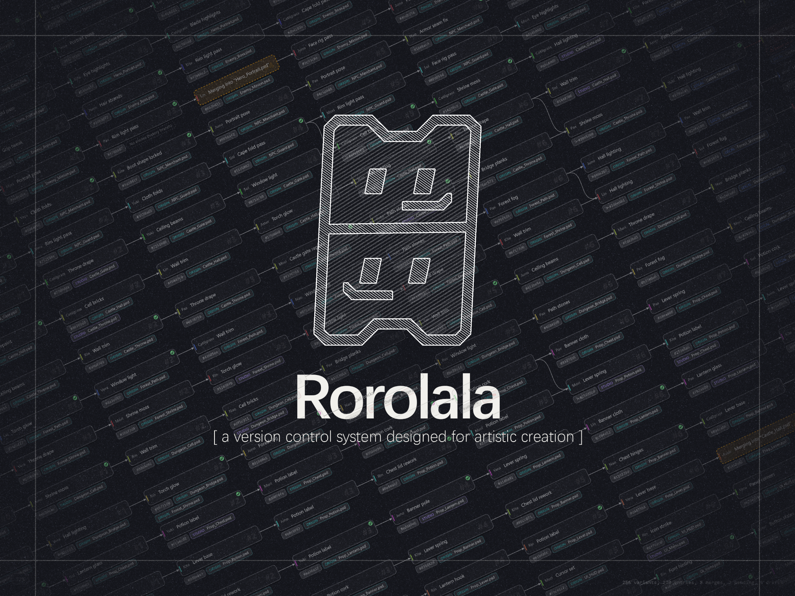
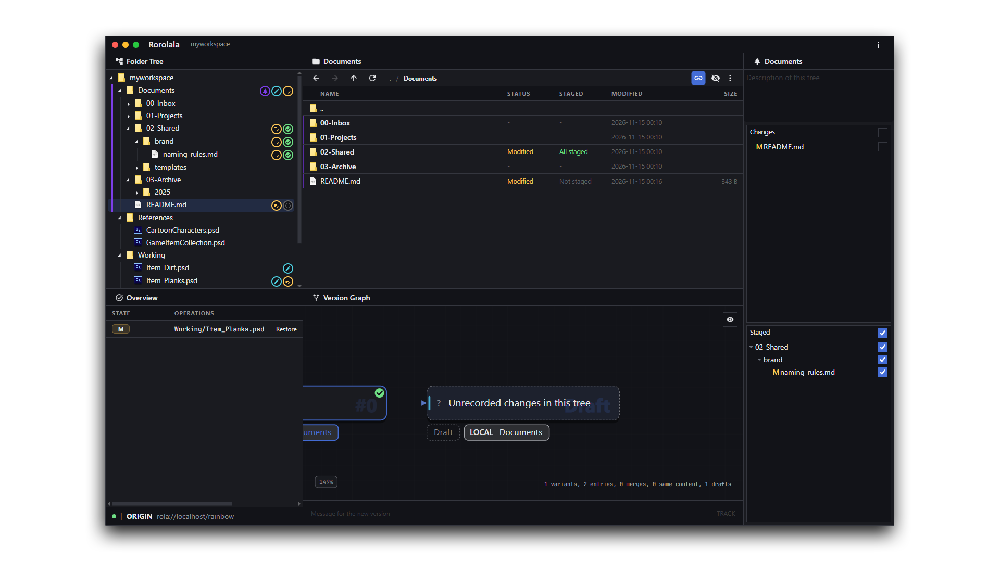
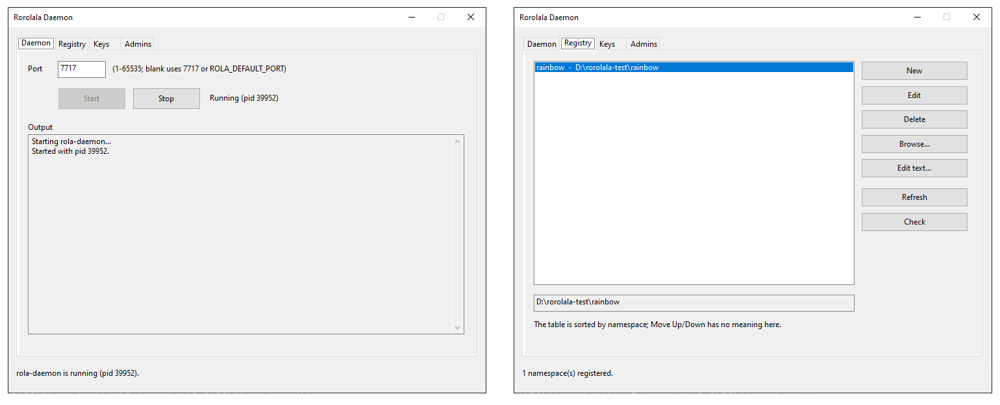
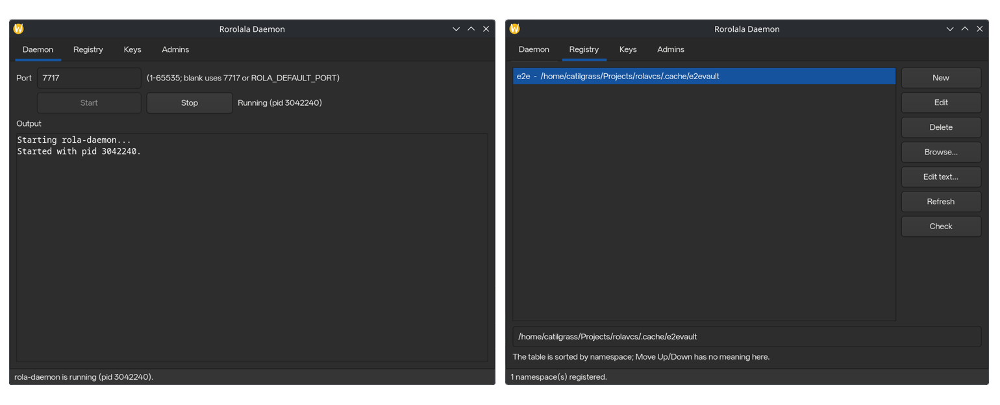

<p align="center">
  
</p>

<h2 style="display: flex; align-items: center; gap: 8px; flex-wrap: nowrap;">RorolalaVCS</h1>

`ROLA` is a version control system designed for **artistic creation and multi-person collaboration**. Its purpose is to let **game and film/TV projects** produce and manage binary asset data more flexibly:

- In `ROLA`, your working directory is called a **"Workspace"**. A workspace can freely check in **individual asset files** or **tree files managed as a whole** from upstream, each tracked by its own **independent version chain**.

- You are free to modify file contents locally, but only the file's **owner** can actually advance its version: **"Don't worry — the GUI will tell you whether you're allowed to modify the file."**

### 1. Local storage

- Inside your local workspace, **all upstream indices** are stored incrementally: they are small, so they can quickly help you find the indices you need.

- Only when you actually materialize the file will the missing chunks be requested and downloaded from upstream, ensuring that **you never download content you don't need**.

### 2. Granularity

`ROLA` uses a hybrid versioning granularity: you can treat a single file as a version chain, or an entire directory as one. This allows assets that depend on relative paths to be locally reproducible, while assets without path dependencies can be managed at a fine-grained level.

### 3. Remote protocols

`ROLA` provides two transport protocols: `ssh` and `rola://`. The `rola` protocol is designed specifically for the `rola-daemon` server program, making it easy to manage asset vaults on a server.

## Download and installation

`ROLA` provides complete pre-built binaries on [GitHub](https://github.com/rorolala-vcs/rorolala-vcs). You can directly [download the latest build](https://github.com/rorolala-vcs/rorolala-vcs/releases/latest)

Alternatively, you can browse and [download previous versions](https://github.com/rorolala-vcs/rorolala-vcs/releases).

### Desktop

After installation, you can find the `ROLALauncher` entry in your system, where you can **connect to a vault and create a workspace**; once inside a workspace, you can check in assets, modify them, and create versions to sync with others:

<p align="center">
  
</p>

### Command line usage

```bash
# Show help
~> rola --help

# Create a workspace
~> mkdir my-workspace && cd my-workspace
~/my-workspace> rola init

# Bind the workspace to a repository
~/my-workspace> rola bind rola://your-vault.com/default
```

## Server deployment

To use `ROLA`, you need a server or another accessible device with `rola-daemon` installed.

### 1. Create a remote repository

`ROLA` needs an empty directory to create a `Vault` for data storage:

```bash
# Create the my-vault/ directory and initialize a Rola Vault inside it
rola create --vault my-vault

# Register the vault under the name `default` (required for the rola protocol)
cd my-vault && rola-daemon register default
```

### 2. Start the server

To support the `rola` protocol, `rola-daemon` must be kept running. You can manage it with `systemd`, or run the `rola-daemon` process yourself:

```bash
# 1. Run rola-daemon directly
rola-daemon

# 2. Start rolad.service via systemd
systemctl --user enable --now rolad.service
```

If you are using `Windows Server` or another `Windows` system, you can simply run `rola-daemon-gui.exe` to quickly manage and start the client:

<p align="center">
  
</p>

On Linux desktops, you can also launch `rola-daemon-gui`, drawn with `GTK4`:

<p align="center">
  
</p>

**After that**, other users can connect to a repository using the `rola://` protocol with the following format:

```text
rola://your.domain:port/namespace

# For example
rola://my-rola-vault.com/default
rola://my-rola-vault.com:7717/default
```

## License

This project is released under the **MIT License**.

Anyone is free to use, copy, modify, merge, publish, distribute, sublicense, and even sell copies of this software. The only requirement is that the original copyright notice and license notice be retained in all copies or substantial portions of the software.

See [LICENSE](./LICENSE) for the full terms.
