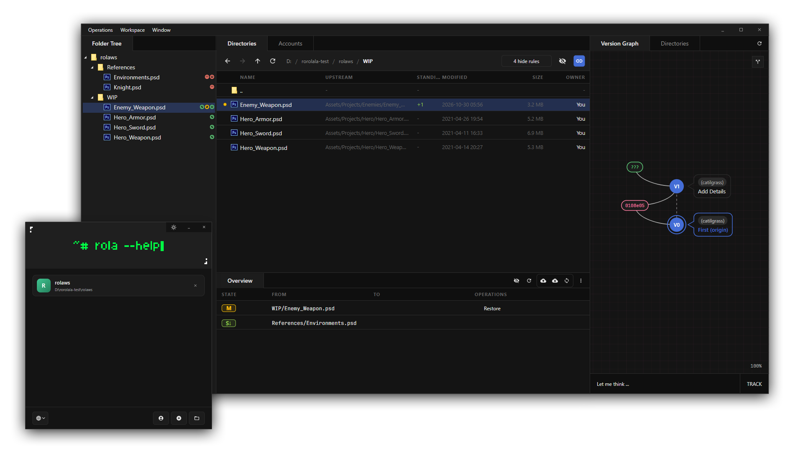

<p align="center">
  <!---->
  
</p>

<p align="center">
    <b>R</b>eality-<b>O</b>riented, <b>L</b>ayout-<b>A</b>gnostic 
</p>

<p align="center">
  <a href="https://github.com/rorolala-vcs/rorolala-vcs/stargazers"></a>
  <a href="https://github.com/rorolala-vcs/rorolala-vcs/network/members"></a>
  <a href="https://github.com/rorolala-vcs/rorolala-vcs/releases/latest"></a>
</p>

This article is available in multiple languages: [English](./README.md)|[中文](./README_zh_CN.md)

## ⭐ Introduction ⭐

`Rorolala VCS` is a version control system designed for artistic creation and multi-person collaboration, built around the following design principles:

### Version Control & Collaboration Model

- Private local file structure: the local file structure is **a description of the user's own working state**, not **a description of the repository state**.

- Version granularity down to individual files: every file has its own version chain, which means you can operate locally without affecting the whole.

### Storage Model

- **Indices**, **versions**, and **data** are stored via **content-addressed storage**.
- **Ownership** and **public paths** are stored via **centralized storage**.
- Indices are stored in full, while content is pulled on demand: versions and ownership can be obtained quickly locally, while **content is only requested and pulled when actually needed**.

## 🚀 Download & Install 🚀

`ROLA` provides complete prebuilt versions on [GitHub](https://github.com/rorolala-vcs/rorolala-vcs) — you can directly [download the latest](https://github.com/rorolala-vcs/rorolala-vcs/releases/latest).

Alternatively, you can view [all versions](https://github.com/rorolala-vcs/rorolala-vcs/releases).

### Desktop

After installation, you can find the `ROLALauncher` launch entry, where you can create or open a workspace; once inside a workspace, you can check-in assets, modify them, and create versions to sync to others:

<p align="center">
  
</p>

### Command Line Usage

```bash
# View help
~> rola --help

# Create a workspace
~> mkdir my-workspace && cd my-workspace
~/my-workspace> rola init

# Connect to a vault within the workspace
~/my-workspace> rola bind rola://your-vault.com/default
```

## Server Deployment

To use `ROLA`, you need a server or another device that can be accessed, with `rola-daemon` installed.

### 1. Create a Remote Vault

`ROLA` requires an empty directory to create a `Vault` for storing data:

```bash
# Create the my-vault/ directory and initialize a Rola Vault inside it
rola create --vault my-vault

# Register this Vault as `default` (required for the rola protocol)
cd my-vault && rola-daemon register default
```

### 2. Start the Server

To support the `rola` protocol, `rola-daemon` must stay running. You can manage it with `systemd`, or run the `rola-daemon` process on your own:

```bash
# 1. Run rola-daemon directly
rola-daemon

# 2. Start rolad.service via systemd
systemctl --user enable --now rolad.service
```

If you are using `Windows Server` or another `Windows` system, you can also directly run `rola-daemon-gui.exe` to quickly manage and start the client:

<p align="center">
  
</p>

On the Linux desktop, you can also launch the `GTK4`-drawn `rola-daemon-gui`:

<p align="center">
  
</p>

**After that**, other users can directly connect to the `rola://` protocol vault using links in the following format:

```text
rola://your.domain:port/namespace

# For example
rola://my-rola-vault.com/default
rola://my-rola-vault.com:7717/default
```

## ❤ Contributors ❤


## 📖 License 📖

This project is released under the **MIT License**. Anyone is free to use, copy, modify, merge, publish, distribute, sublicense, and even sell copies of this software; the only requirement is to retain the original copyright notice and license notice in all copies or substantial portions of the software.

For the full terms, see [LICENSE](./LICENSE).
