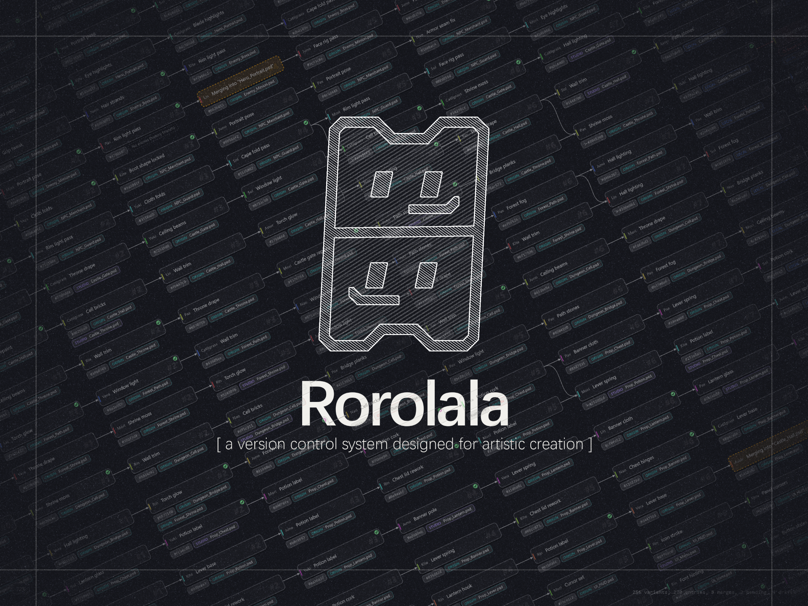
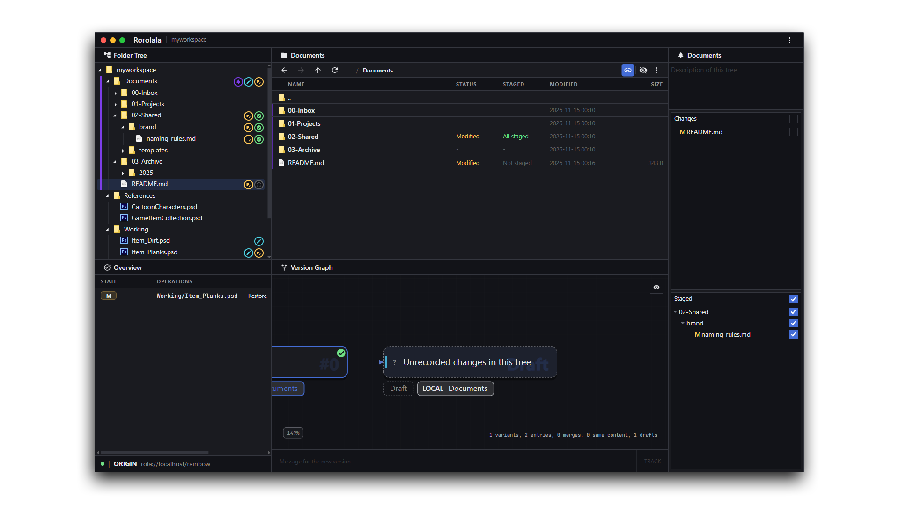
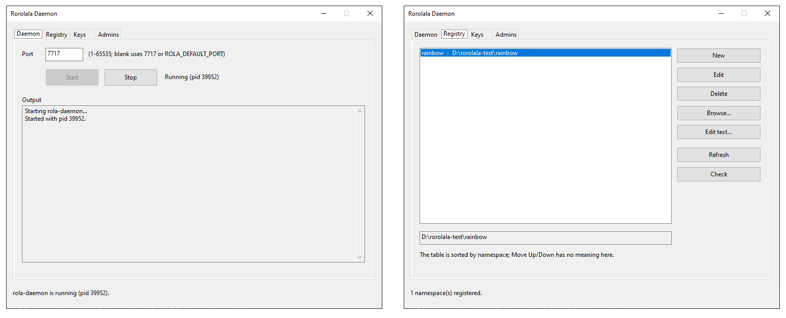
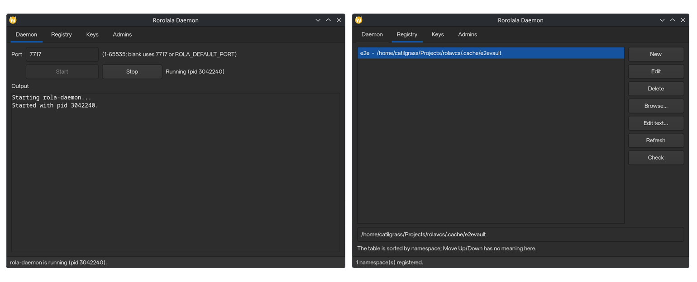

<p align="center">
  
</p>

本文章提供了多种语言：[English](./README.md) | [中文](./README_zh_CN.md)

<h2 style="display: flex; align-items: center; gap: 8px; flex-wrap: nowrap;">RorolalaVCS</h1>

`ROLA` 是一款为 **艺术创作和多人协作** 设计的版本控制系统，它设计出来的目的是为了 **让游戏、影视项目** 可以更灵活地生产和管理二进制资产数据：

- 在 `ROLA` 中，你的工作目录被称作 **"工作区 (Workspace)"**，工作区可以任意地签入 (Check-in) 上游中的 **单体素材文件** 或 **被作为整体管理的树文件**，他们由自身的 **独立版本链** 所管理。

- 你可以自由地在本地修改文件内容，但只有该文件的 **所有者** 才能真正移动版本：**“放心，GUI 会告诉你是否可以修改该文件的。”**

### 1. 本地存储

- 你的本地工作区内，会增量存储上游的 **所有索引**：它们很小，所以可以快速辅助你找到所需的索引。

- 当你真正要建立该文件时，才会因为块缺失向上游请求下载缺失的部分，这保证了 **你不会下载到你不需要的内容**。

### 2. 管理粒度

`ROLA` 采用了混合的版本控制粒度：你可以将单个文件作为版本链，也可以将整个目录作为版本链，这使得依赖相对路径的资产可以被局部可复现，而那些无路径依赖的资产可以细粒度管理。

### 3. 远程协议

`ROLA` 提供了两种传输协议：`ssh` 协议和 `rola://` 协议，其中 `rola` 协议是专门为 `rola-daemon` 服务端程序设计的，它可以很方便地管理服务器上的资产保险库 (Vault)

## 下载和安装

`ROLA` 在 [GitHub](https://github.com/rorolala-vcs/rorolala-vcs) 提供了完整的预构建版本，你可以直接 [下载最新构建版本](https://github.com/rorolala-vcs/rorolala-vcs/releases/latest)

或者，你也可以查看并 [下载历史版本](https://github.com/rorolala-vcs/rorolala-vcs/releases)。

### 桌面端

安装完成后，你可以在系统中找到 `ROLALauncher` 启动入口，在这里你可以连接 **保险库并创建工作区**；进入工作区后，你可以签入素材、修改它们，并创建版本以同步给其他人：

<p align="center">
  
</p>

### 命令行使用

```bash
# 查看帮助
~> rola --help

# 创建工作区
~> mkdir my-workspace && cd my-workspace
~/my-workspace> rola init

# 在工作区内连接到仓库
~/my-workspace> rola bind rola://your-vault.com/default
```

## 服务端部署

`ROLA` 要使用，你需要一台服务器或其他可以被访问的设备，且必须安装了 `rola-daemon`。

### 1. 创建远程仓库

`ROLA` 需要一个空目录创建 `Vault` 来存储数据：

```bash
# 创建 my-vault/ 目录，并在内部初始化 Rola Vault
rola create --vault my-vault

# 注册该 Vault，名为 `default`（rola 协议必选）
cd my-vault && rola-daemon register default
```

### 2. 启动服务端

若要支持 `rola` 协议，需要保持 `rola-daemon` 的启动，你可以使用 `systemd` 来管理，或者自主运行 `rola-daemon` 进程：

```bash
# 1. 直接运行 rola-daemon
rola-daemon

# 2. systemd 启动 rolad.service
systemctl --user enable --now rolad.service
```

如果你使用的是 `Windows Server` 或其他 `Windows` 系统，也可以直接运行 `rola-daemon-gui.exe` 来快速管理和启动客户端：

<p align="center">
  
</p>

在 Linux 桌面上，你也可以使用由 `GTK4` 绘制的 `rola-daemon-gui` 启动：

<p align="center">
  
</p>

**之后**，其他用户便可以直接使用如下格式的链接来连接到 `rola://` 协议的仓库

```text
rola://your.domain:port/namespace

# 例如
rola://my-rola-vault.com/default
rola://my-rola-vault.com:7717/default
```

## 许可证

本项目基于 **MIT 许可证** 发布。

任何人都可以自由使用、复制、修改、合并、发布、分发、再许可，乃至销售本软件的副本，唯一的要求是在本软件的所有副本或重要部分中保留原始的版权声明与许可声明。

完整条款请参见 [LICENSE](./LICENSE)
