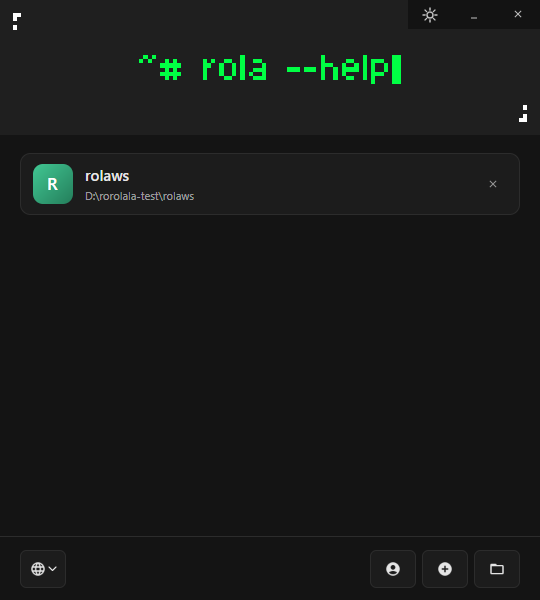
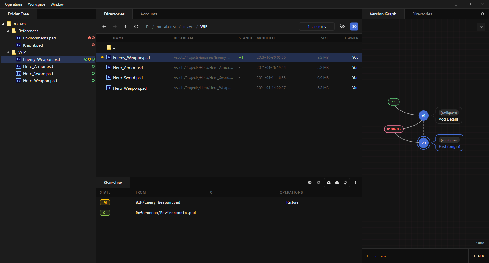
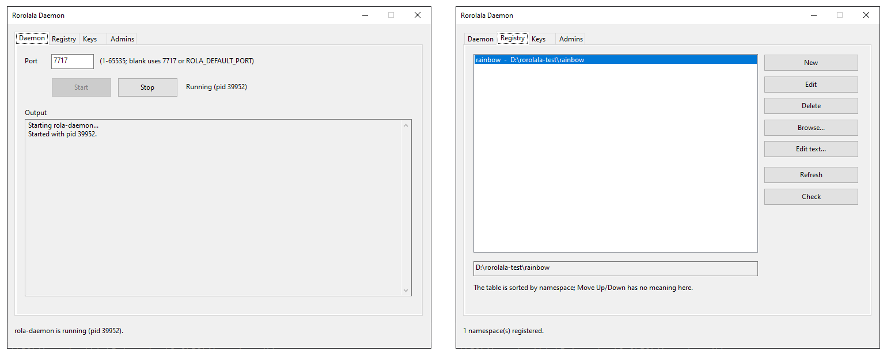
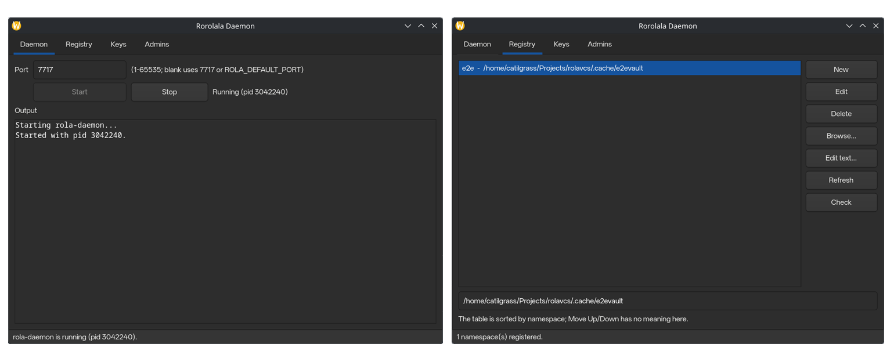

<p align="center">
  <!---->
  
</p>

<p align="center">
    <b>R</b>eality-<b>O</b>riented, <b>L</b>ayout-<b>A</b>gnostic 
</p>

本文章提供了多种语言：[English](./README.md)|[中文](./README_zh_CN.md)

## ⭐ 简介 ⭐

`Rorolala VCS` 是一款为艺术创作和多人协作设计的版本控制系统，包含如下设计：

### 版本控制 & 协作模式

- 本地文件结构私有化：本地文件结构是 **用户对自身工作状态的描述** 而非 **仓库状态的描述**。

- 版本粒度细化到逐个文件：每个文件都有自己的版本链，这意味着你可以局部操作而不影响全局。

### 存储模型

- **索引**、**版本** 还有 **数据** 会被 **内容寻址存储**
- **所有权**、**公共路径** 会被 **集中式存储**
- 完整存储索引，按需拉取内容：本地可以快速获取版本、所有权，而只有 **真正需要内容时才请求拉取**。

## 🚀 下载 & 安装 🚀

`ROLA` 在 [GitHub](https://github.com/rorolala-vcs/rorolala-vcs) 提供了完整的预构建版本，你可以直接 [下载最新](https://github.com/rorolala-vcs/rorolala-vcs/releases/latest)

或者，你也可以查看 [所有版本](https://github.com/rorolala-vcs/rorolala-vcs/releases)。

### 桌面端

安装后，你可以找到 `ROLALauncher` 的启动条目，在里面你可以创建或打开工作区：



进入工作区后，你可以签入素材、修改素材并创建版本同步给他人：



### 命令行使用

```bash
# 查看帮助
~> rola --help

# 创建工作区
~> mkdir my-workspace && cd my-workspace
~/my-workspace> rola init

# 在工作区内连接到仓库
~/my-workspace> rola bind rola://your-vault.com/default
```

## 服务端部署

`ROLA` 要使用，你需要一台服务器或其他可以被访问的设备，且必须安装了 `rola-daemon`。

### 1. 创建远程仓库

`ROLA` 需要一个空目录创建 `Vault` 来存储数据：

```bash
# 创建 my-vault/ 目录，并在内部初始化 Rola Vault
rola create --vault my-vault

# 注册该 Vault，名为 `default`（rola 协议必选）
cd my-vault && rola-daemon register default
```

### 2. 启动服务端

若要支持 `rola` 协议，需要保持 `rola-daemon` 的启动，你可以使用 `systemd` 来管理，或者自主运行 `rola-daemon` 进程：

```bash
# 1. 直接运行 rola-daemon
rola-daemon

# 2. systemd 启动 rolad.service
systemctl --user enable --now rolad.service
```

如果你使用的是 `Windows Server` 或其他 `Windows` 系统，也可以直接运行 `rola-daemon-gui.exe` 来快速管理和启动客户端：



在 Linux 桌面上，你也可以使用由 `GTK4` 绘制的 `rola-daemon-gui` 启动：



**之后**，其他用户便可以直接使用如下格式的链接来连接到 `rola://` 协议的仓库

```text
rola://your.domain:port/namespace

# 例如
rola://my-rola-vault.com/default
rola://my-rola-vault.com:7717/default
```

## ❤ 贡献者 ❤


## 📖 许可证 📖

本项目基于 **MIT 许可证** 发布。任何人都可以自由使用、复制、修改、合并、发布、分发、再许可，乃至销售本软件的副本，唯一的要求是在本软件的所有副本或重要部分中保留原始的版权声明与许可声明。

完整条款请参见 [LICENSE](./LICENSE)。
